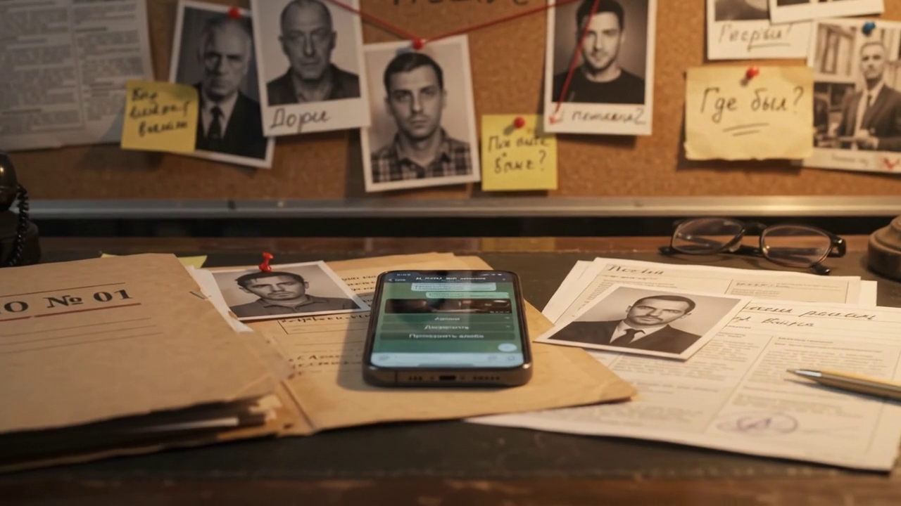

# Детективный клуб — Telegram-бот с ИИ-рассказчиком

**Работающий проект:** [@AI_CH_BOT_univers_bot](https://t.me/AI_CH_BOT_univers_bot)

Интерактивные детективные истории в Telegram: игрок расследует дело, собирает улики, допрашивает подозреваемых и называет виновного. ИИ-рассказчик оживляет завязку и отвечает на свободные вопросы, а исход определяет игровой движок, а не модель.

> Исходный код закрытый. Здесь описание проекта.

## Что внутри

- **Движок дел:** улики, персонажи со статусами, допросы, алиби, досье, подсказки, таймер, обвинение и финал. 19 дел, новые добавляются через JSON без правки кода.
- **ИИ-рассказчик:** любой OpenAI-совместимый API; без ИИ бот продолжает работать по кнопкам; суточный лимит реплик защищает расход ключа.
- **Тарифы:** Free, Premium, VIP; цены и лимиты в одном файле, ручная оплата вне Telegram, условия возврата.
- **Админ-панель в боте:** статистика, поиск, бан, обратная связь, аудит.
- **Запуск:** сервис systemd с изоляцией, автоперезапуск, 193 автотеста.

## Стек

## Автор

Олег · [gonka.blog](https://gonka.blog) · textsmen@gmail.com
